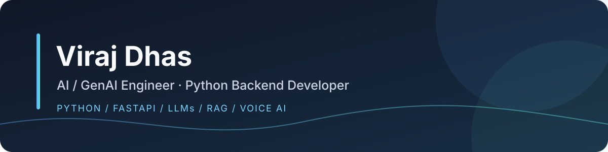

  

<h1 align="center">Hi, I'm Viraj Dhas</h1>

  <strong>AI / GenAI Engineer · Python Backend Developer</strong>

  I build backend systems and applied AI solutions using Python, FastAPI, LLMs,
  retrieval-augmented generation, and real-time voice technologies.

  <a href="https://viraj1711.github.io/viraj-portfolio/">Portfolio</a>
  &nbsp;·&nbsp;
  <a href="https://github.com/Viraj1711">GitHub</a>
  &nbsp;·&nbsp;
  <a href="mailto:dhasviraj0707@gmail.com">Email</a>

---

## About

I'm a Python developer focused on backend engineering and practical AI systems. My work spans API development, asynchronous services, LLM-powered retrieval, conversational interfaces, and workflow automation.

- **Current role:** Junior Python Developer (AI & Automation)
- **Focus:** Python backend systems, GenAI applications, RAG, AI agents, and Voice AI
- **Location:** Pune, India
- **Portfolio:** [viraj1711.github.io/viraj-portfolio](https://viraj1711.github.io/viraj-portfolio/)

## What I Build

- **LLM applications:** LLM integration, RAG pipelines, embeddings, vector search, and agentic workflows.
- **Real-time voice systems:** WebSocket-based audio streaming, speech-to-text, text-to-speech, and voice interfaces.
- **Backend services:** Asynchronous Python APIs, REST integrations, authentication, and data-backed services.
- **Automation and quality:** Browser/workflow automation, API testing, unit testing, and CI/CD.

## Technical Skills

| Area | Technologies |
|---|---|
| Languages | Python, SQL, JavaScript |
| Backend | FastAPI, Django, REST APIs, AsyncIO, WebSockets, JWT |
| AI / GenAI | LLM integration, RAG, LangChain, AI agents, agentic workflows, prompt engineering, context engineering, embeddings |
| Retrieval | Vector search, hybrid search, knowledge-base retrieval |
| Voice AI | Deepgram, ElevenLabs, STT, TTS, VAD |
| Databases & messaging | MongoDB, PostgreSQL, Redis, Redis Pub/Sub |
| Automation & testing | Playwright, Selenium, BotCity, PyTest, unit testing |
| Cloud & DevOps | Microsoft Azure, Docker, GitHub Actions, CI/CD, Linux |
| Additional | Scikit-learn, OpenCV, YOLOv5, TensorFlow, Power BI |

## Selected Engineering Work

### Real-Time Voice Agent & Agent Assist

**Professional experience — current role**

- Worked on full-duplex voice-agent and agent-assist platforms using Python, FastAPI, AsyncIO, WebSockets, Deepgram, and ElevenLabs.
- Contributed to a dual-model agent-assist architecture combining fast intent suggestions with retrieval over vector knowledge bases.
- Used Redis Cache and Pub/Sub for multi-session state and streaming workflows.
- Resume-reported outcomes: sub-800ms voice-interaction latency and 85%+ RAG retrieval accuracy in the described workflows.

> This is a high-level summary of professional experience, not a claim that employer-owned code is publicly available.

### Blockchain-Based Certificate Verification

**Personal project**

- Developed a certificate-verification system using Python, Django, React.js, SQL, SHA-256, and Merkle Tree hashing.
- Designed tamper-evident verification for academic certificates.
- Resume-reported validation: 1,000+ certificates.

### Suspicious Activity & Object Detection

**Personal project**

- Built a real-time video-analysis and anomaly-identification dashboard.
- Used Python, Django, OpenCV, YOLOv5, and TensorFlow.
- Resume-reported detection accuracy: 92%.

## Current Focus

- Building reliable Python APIs and asynchronous services.
- Improving retrieval quality and evaluation for RAG applications.
- Designing practical LLM and agent workflows.
- Exploring real-time, low-latency voice interfaces.

## Let's Connect

- **Portfolio:** [viraj1711.github.io/viraj-portfolio](https://viraj1711.github.io/viraj-portfolio/)
- **GitHub:** [github.com/Viraj1711](https://github.com/Viraj1711)
- **Email:** [dhasviraj0707@gmail.com](mailto:dhasviraj0707@gmail.com)

---

  Focused on useful software, clear engineering, and continuous learning.

